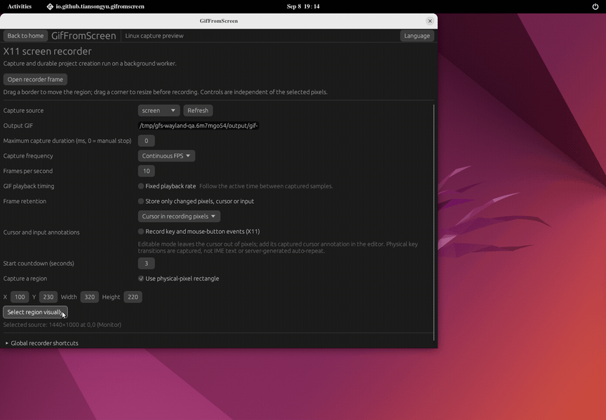

# GifFromScreen

[](https://github.com/tiansongyu/gifromscreen/actions/workflows/ci.yml)
[](https://github.com/tiansongyu/gifromscreen/releases/latest)
[](Cargo.toml)
[](#license)

**Your screen. A GIF worth sharing.** A screen recorder and frame editor for Linux, built in Rust. Capture a region, refine every frame and export locally.

[Website](https://tiansongyu.github.io/gifromscreen/) · [Feature coverage](docs/FEATURE_MATRIX.md) · [Installation](docs/PACKAGING.md) · [Contributing](CONTRIBUTING.md) · [Releases](https://github.com/tiansongyu/gifromscreen/releases)

[](https://tiansongyu.github.io/gifromscreen/)

Recorded from the real X11 app. The demo shows an earlier interface; see [recording details](docs/assets/README.md).

## Install

Linux x86_64:

```sh
curl --proto '=https' --tlsv1.2 -LsSf https://github.com/tiansongyu/gifromscreen/releases/latest/download/gifromscreen-installer.sh | sh
```

Launch **GifFromScreen** from your applications menu, or run `gif-from-screen` with `~/.local/bin` on your `PATH`. The installer downloads the latest stable release, verifies its SHA-256 checksum and adds the desktop app and CLI under `~/.local`. Python 3.8+ is required; Rust and administrator access are not. It leaves shell configuration unchanged. For a different installed version, save your projects and run its uninstaller before installing again; [installation and removal](docs/PACKAGING.md#installation-and-removal).

Prefer a portable download? Get the [v0.1.0 archive](https://github.com/tiansongyu/gifromscreen/releases/download/v0.1.0/gifromscreen-0.1.0-linux-x86_64.tar.gz) and its [SHA-256 file](https://github.com/tiansongyu/gifromscreen/releases/download/v0.1.0/gifromscreen-0.1.0-linux-x86_64.tar.gz.sha256), then run these commands in the download directory:

```sh
sha256sum --check gifromscreen-0.1.0-linux-x86_64.tar.gz.sha256
tar -xzf gifromscreen-0.1.0-linux-x86_64.tar.gz
cd gifromscreen-0.1.0-linux-x86_64
sha256sum --check SHA256SUMS
./bin/gif-from-screen
```

Release packages target **Linux x86_64, Ubuntu 22.04 / glibc 2.35+**, with an X11 or Wayland desktop and a working OpenGL ES or Vulkan driver. Wayland capture needs PipeWire and your desktop's xdg-desktop-portal backend. System `ffmpeg` and `ffprobe` are optional dependencies for video import. Packages are unsigned; checksums detect download corruption. [System libraries](packaging/linux/README.txt).

The published stable package is **v0.1.0**; the source workspace is **0.1.2**. Source builds include the [recording-frame drag grip](docs/RECORDER-DRAG-HANDLE.md) and [graphics startup fix](docs/GRAPHICS-BACKEND-STARTUP.md), which are absent from the v0.1.0 archive. [Development artifacts](https://github.com/tiansongyu/gifromscreen/actions/workflows/portable.yml) require GitHub sign-in and expire after 30 days.

If v0.1.0 fails on X11/NVIDIA with `incompatible_surface_backends: Backends(GL)`, launch it with `WGPU_BACKEND=vulkan ./bin/gif-from-screen` from the portable directory, or `WGPU_BACKEND=vulkan gif-from-screen` after installation.

<a id="从源码运行"></a>

## Run from source

Install Git, [Rust through rustup](https://rustup.rs/) (1.88 or newer) and native build tools. On Ubuntu 22.04 or newer:

```sh
sudo apt-get update
sudo apt-get install --yes build-essential pkg-config clang libclang-dev \
  libpipewire-0.3-dev libwayland-dev libxkbcommon-dev \
  libxkbcommon-x11-dev libxcb-shape0-dev libxcb-xfixes0-dev
```

```sh
git clone https://github.com/tiansongyu/gifromscreen.git
cd gifromscreen
cargo run --locked -p gif-from-screen                    # Desktop app
cargo run --locked -p gif-from-screen-cli -- doctor      # Environment diagnostics
cargo build --release --locked -p gif-from-screen -p gif-from-screen-cli
./target/release/gif-from-screen                        # Optimized build
```

Build dependencies and packaging checks are maintained in the [Linux CI](.github/workflows/ci.yml) and [portable workflow](.github/workflows/portable.yml).

## Use

1. **Record.** Open the screen recorder and choose a source and region. Resize before recording; pause and move the fixed-size region when needed. X11 uses a desktop recording frame. Wayland asks for sharing permission, then lets you crop within the authorized source.
2. **Edit.** Stop recording to open the editor. Remove unwanted frames, adjust their timing, crop the image or add annotations. Use undo and redo to refine your changes.
3. **Export.** Choose all or selected frames, set colors, looping, transparency and dithering, then export a GIF. Save the `.gfsproj` project to continue editing later.

### Command line

The portable package includes `bin/gif-from-screen-cli`; the installer also adds it to `~/.local/bin`.

```sh
gif-from-screen-cli doctor
gif-from-screen-cli demo demo.gif
gif-from-screen-cli sources-x11
gif-from-screen-cli record-x11 capture.gif 3000 10        # Three seconds at 10 FPS
gif-from-screen-cli export project.gfsproj output.gif
gif-from-screen-cli export project.gfsproj selected.gif '1,3-5,9-7'
```

Run `gif-from-screen-cli --help` for command syntax. Export frame expressions are one-based; ranges preserve their written direction. CLI screen recording uses X11.

## Features

| Area | What you can do |
| --- | --- |
| Recording | Countdown, pause/resume, stop and save, or explicitly discard; continuous capture, periodic/manual snapshots and X11 interaction-triggered snapshots |
| Frame editing | Select, reorder, cut/copy/paste, change delays, reduce frames, remove duplicates and create Yoyo loops |
| Image editing | Crop, resize, rotate, flip and add fade or slide transitions |
| Annotations | Captions, title frames, watermarks, shapes, freehand drawing, borders, shadows, progress, key/click/cursor annotations and editable layers |
| Sources | Import GIF, PNG/JPEG/BMP/WebP, image sequences or video; create blank animations, record a drawing board or use the camera entry point |
| Projects | Incremental recording saves, recovery of persisted frames, Save As, recent projects and reusable edit/export presets |

The [shape canvas](docs/VECTOR-SHAPE-CANVAS.md) supports multiple shapes with selection, move, resize and rotation. Current projects use schema 8 and Vector v1. Detailed capability boundaries are recorded in [feature coverage](docs/FEATURE_MATRIX.md) and the [work summary](docs/WORK-STATUS.md).

## Desktop support

| Capability | X11 | Wayland |
| --- | --- | --- |
| Region selection | Desktop frame, numeric positioning, window picking and snapping | System Portal source selection, followed by preview cropping |
| Movement during capture | Move a fixed-size desktop region | Move a fixed-size crop inside the authorized source |
| Recorder controls | Separate from the recording region | Keep controls outside monitor captures |
| Global shortcuts | Optional, configurable bindings | GlobalShortcuts Portal; desktop support and authorization required |
| Input and cursor annotations | Optional key/button metadata and editable cursors | Embedded or hidden cursor; manual annotations available |

Wayland source sharing, placement and refresh depend on the compositor and portal. A window source is usually easier to keep clear of recording controls. Occluded applications may stop repainting. [Linux status](docs/LINUX-STATUS.md).

## Controls

Global recorder shortcuts are **off by default**. Enable them in the recorder and customize the bindings there. They are active within the recorder scope; source selection and authorization still apply.

| Default shortcut | Action |
| --- | --- |
| `Ctrl+Shift+F7` | Prepare the recorder, start when ready, or pause/resume recording |
| `Ctrl+Shift+F8` | Cancel preparation/countdown, or stop and save |
| `Ctrl+Shift+F9` | Capture a frame in manual-snapshot mode |

Buttons remain available if shortcut registration fails. [Shortcut behavior and desktop requirements](docs/GLOBAL-SHORTCUTS.md).

## Languages

The app follows the system locale. Choose **Language** to save an override across restarts. English and Simplified Chinese cover the main recording and editing workflows; some forms, shared widgets and diagnostics remain untranslated. The other 27 language choices currently fall back to English. [Localization scope](docs/LOCALIZATION-PLAN.md).

## Known limits

- GIF is the only export format. Audio recording is not supported.
- Camera recording has an entry point, but physical-device acceptance is pending.
- Broader GNOME/KDE, physical multi-monitor and mixed-DPI setups, long high-resolution recordings and some effect-fidelity cases need further validation.
- In v0.1.0, launcher text can overlap in narrow windows at 150% application zoom. Use 100% zoom or widen the window.

Key/click metadata collection is off by default. If enabled, review projects for sensitive input before sharing. Exported GIFs omit project input metadata; visible annotations remain in the images.

## Contributing

See [CONTRIBUTING.md](CONTRIBUTING.md) for development guidance and [CHANGELOG.md](CHANGELOG.md) for changes. To report a bug, include reproduction steps, the release tag or commit, Linux distribution, X11/Wayland session and monitor setup. Remove personal information from logs and sample projects.

Run the applicable checks before submitting a code change:

```sh
cargo fmt --all -- --check
cargo clippy --locked --workspace --all-targets --all-features -- -D warnings
cargo test --locked --workspace --all-targets --all-features
```

Website and installer maintenance are documented in [website/README.md](website/README.md).

## License

[MIT](packaging/licenses/LICENSE-MIT) or [Apache-2.0](packaging/licenses/LICENSE-APACHE), at your option. Some numerical algorithms are ported from dotnet/WPF under MIT; third-party sources and licenses are listed in [NOTICE](packaging/licenses/NOTICE.txt).
