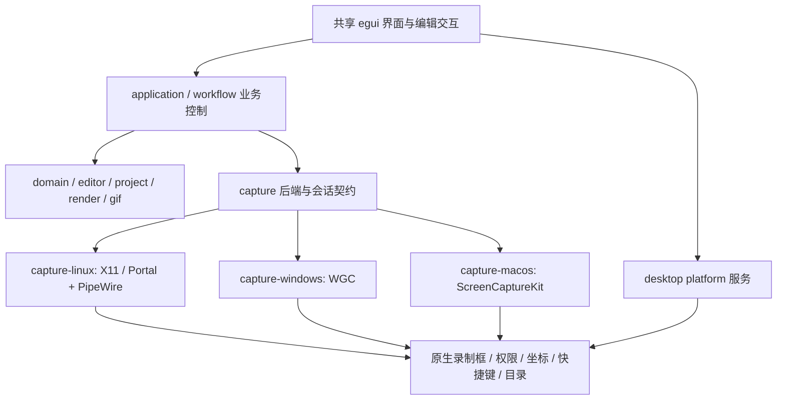
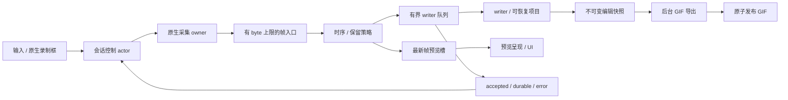
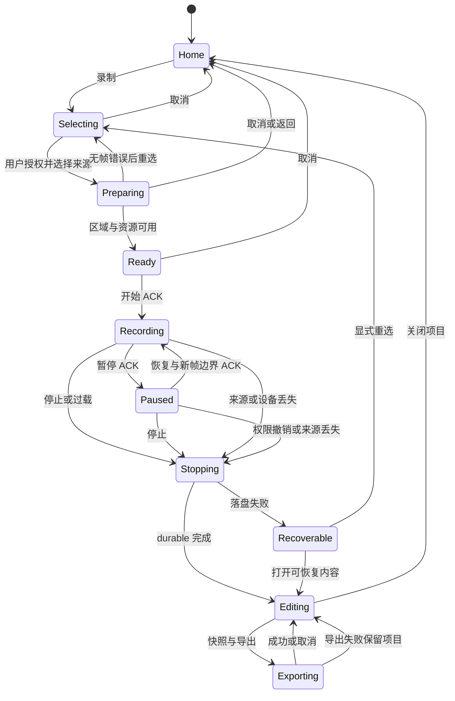

# 跨平台与帧率优先方案

这是一份待评审的实施方案。推荐保留 Rust、egui/eframe、现有领域模型、项目恢复和流式 GIF 导出；通过平台适配层接入原生采集和录制框，并将采集、预览、持久化分别调度。首先解决可观测性和同步落盘阻塞，再按原生设备验收结果优化 GPU 路径。

**本轮交付是设计与调查，Windows/macOS 后端尚未实现；1080p60 和真实显示器流畅度尚未实测。** 本文不改变现有功能、项目格式或发布支持声明。

配套文档：[代码审查与官方资料](CROSS-PLATFORM-RESEARCH.md)、[性能预算与验收协议](CROSS-PLATFORM-PERFORMANCE.md)。代码引用固定到上述基线的文件位置；本次只新增这三份文档。

证据标签：**【实现】** 已检查的现有代码；**【验证】** 已执行测试或查到明确 CI 结果，范围以记录为限；**【官方】** 官方 API/上游源码说明；**【建议】** 尚未实施的方案；**【待验】** 需要目标系统、硬件或实验确认。下文“必须”描述建议方案的契约，不代表当前已实现。

## 1. 范围与取舍

优先级依次为：输入和录制框跟手 → 采集节奏与时序 → 长录制稳定性和恢复 → 三平台核心体验 → 编辑功能。GIF MVP 闭环是来源选择、区域裁剪、开始/暂停/继续/停止、录制预览、帧选择/删除、播放速度、GIF 导出、项目保存/恢复。

新增音频、视频导出、摄像头、复杂特效、矢量编辑、插件和云同步暂缓。现有高级编辑代码及旧项目读取能力继续保留；它们不成为新平台首次录制的依赖。

| 路线 | 收益 | 成本与限制 | 建议 |
| --- | --- | --- | --- |
| 现有 Rust 核心 + egui/eframe + 原生采集/窗口适配 | 复用恢复、编辑、导出及测试；可逐个后端交付 | 原生线程、GPU 互操作和平台 UI 仍需适配 | **采用**，先测量实际瓶颈 |
| 保留 Rust 核心，三平台分别实现全部原生 UI | 原生窗口生命周期和控件整合更直接 | 三套编辑器、布局、文本与状态绑定；迁移面大 | 原生录制框可局部采用，暂不重写编辑器 |
| 更换完整 UI 框架或改成 Web 壳 | 可使用其他界面生态 | 没有证据表明能解决当前同步存储、复制和采集时序问题；增加迁移风险 | 仅当原型证明现框架存在不可绕过的门槛时重评 |

【实现】当前采集已在后台 worker，GIF 导出也已在后台。问题不是简单地“再开一个线程”：录制 worker 同步完成采集、复制、资产校验写入和 journal 同步；主编辑预览 cache miss 则仍有 UI 同步读盘与 CPU 渲染。详见[热路径审查](CROSS-PLATFORM-RESEARCH.md#2-录制和预览热路径)。

## 2. 共享与平台边界

以下位置中，`capture-windows`、`capture-macos` 和 `desktop/src/platform/` 是**建议新增**，其余目录已经存在。



| 模块 | 处理 | 职责与理由 |
| --- | --- | --- |
| `crates/domain`, `editor`, `localization`, `text`, `media` | 保留 | 项目/帧/命令、基础编辑、语言与媒体模型可共享；平台编译仍须验证 |
| `crates/project` | 保留并小步扩展 | 资产、journal、checkpoint、迁移与恢复；存储新路径不能绕开恢复契约 |
| `crates/gif`, `render` | 保留与调优 | 流式量化、时间累计舍入、渲染、差分与取消基础已经存在 |
| `crates/capture` | 扩展 | 保留 `CaptureBackend`、`CaptureSession`、`CaptureCapabilities`；补时钟、代次和缓冲租约 |
| `crates/workflow`, `application` | 重构热路径 | 控制、采样、时间线与 writer 解耦；保持 sink-only 的有界像素工作集 |
| `crates/capture-linux` | 保留并测量 | X11 原生 guide、GetImage 和 Wayland 授权路径；逐步引入 PTS/指标及可选优化 |
| `crates/capture-windows`, `capture-macos` | 新增 | 原生采集、对象生命周期和平台错误隔离 |
| `apps/desktop/src/platform/` | 新增薄服务层 | 后端工厂、原生窗口/权限、目录、安全文件操作、快捷键；避免跨平台业务散落 cfg |
| `apps/desktop/src/editor_preview.rs` 等 | 局部重构 | 主预览改异步，保留现有缩略图任务和导出快照架构 |
| `apps/cli` | 隔离平台子命令 | 共享 doctor/export/demo；X11 命令 target-gate，未实现后端明确报告不可用 |
| 高级效果、GPU 全链路、DMA-BUF 导入 | 暂缓或独立实验 | 不阻塞基础闭环；以性能证据决定投入，不承诺全链路零拷贝 |

### 2.1 能力、权限与线程

【实现】能力已有 `Available / Limited / PermissionRequired / Unavailable`，来源 geometry 已允许 `None`。复用这些状态，补充窗口排除、运行中移动、GPU 预览、颜色范围和快捷键的服务能力。权限变化后重新发布能力快照；`is_supported()` 不等于 `is_ready()`。

【建议】系统选择器通过 UI 主线程发起异步任务。取消选择回到原界面，不标记为采集故障；不得在取消后自动授权或切换成另一块屏幕。同步 `list_sources/start_session` 仅在允许的 worker 调用；需要主线程的后端通过有界请求代理完成。UI 不等待该调用。原生对象留在所属线程/队列，`Send` 会话可以是消息代理，不通过无依据的 `unsafe impl Send` 穿透约束。

建议接口增量（伪代码，非现有 API；应分批加入现有契约）：

```rust
struct FrameIdentity { source_generation: u64, region_generation: u64, sequence: u64 }
// 归档ID在整个录制内单调，不随原生source重启/sequence重置而复用。
struct ArchiveId { recording: RecordingId, ordinal: u64 }
struct NativeTime { clock: ClockDomainId, ticks: i64, ticks_per_second: u64 }
enum TimestampQuality { Native, EstimatedBeforeRead, CallbackArrival }
enum TimeBasis { NativeContinuous, SessionActive }
struct FrameTiming {
    native: Option<NativeTime>, received_ns: u64,
    quality: TimestampQuality, basis: TimeBasis,
}
// CPU 帧是有 byte permit 的不可变租约；最后一个读者释放后回到池。
// NativeSurfaceToken 是平台 actor 内部槽位的句柄，不是可任意跨线程的 COM/ObjC 指针。
enum FramePayload { Cpu(CpuFrameLease), Native(NativeSurfaceToken) }
struct FrameEnvelope { id: FrameIdentity, timing: FrameTiming, pixels: FramePayload }
enum WriterAck {
    Accepted(ArchiveId),
    Durable { through: ArchiveId, revision: u64 }, // 含时长修正的连续commit水位
    Failed { recording: RecordingId, error: StorageFailure },
}
struct GeometryCommit { gesture: u64, generation: u64, crop: SourceLocalPxRect }
struct GeometryAck { generation: u64, effective_after: Option<NativeTime> }
enum SessionEvent { SourceLost, PermissionRevoked, DeviceLost, Overrun, Failed(CaptureError) }
```

`CapturedFrame` 的 CPU 路径继续可用。`FrameEnvelope` 是传输边界概念，不把 GPU 句柄序列化进项目。第一批实现可只采用 CPU 租约与新的时序元数据，GPU token 在原型验证后加入。申请缓冲区必须先取得 byte permit；原生池、CPU 池、读回和预览缓存分别计账，共享引用只计一次实际存储。

### 2.2 坐标和颜色契约

【建议】至少区分 `LogicalUiRect`、有符号 `DesktopPxRect`、`SourceLocalPxRect`、`MacPointsRect` 和可缺失的 `PortalCompositorRect`。不要继续将不同空间都用一个无单位矩形跨模块传递。保留原 `PhysicalRect` 的旧接口适配器以降低迁移面。

每个来源快照携带 source id、代次、原点、尺寸、方向、缩放与变换。源内裁剪最终采用整数物理像素、半开区间，明确向外取整并裁边；窗口frame/client/content边界和纹理stride分别说明。负坐标属于桌面空间；source-local 裁剪不通过主屏缩放计算。Wayland 未提供可对应的全局位置时保持 `None`，用已授权画面内的裁剪编辑替代桌面定位。显示器断开、方向/缩放变化会使旧变换失效，递增代次并重新确认区域。

macOS先将AppKit桌面points按所属显示器及原点/旋转映射到所选SCK来源的points，再以该来源metadata转换为像素；不将全局桌面统一乘一个Retina倍率。跨DPI来源不能用单个scale描述完整变换；MVP每次选一个来源，跨显示器扩大录制区域需重新选源或作为后续拼接能力。

MVP 使用明确的 SDR 8-bit RGBA/BGRA 格式、stride、alpha 语义及颜色空间。只有需要归档/编码时才标准化；tight RGBA 不再无条件复制。HDR/P3/多平面格式必须显式转换或报告受限，不能默默以 BGRA8 当作正确 HDR 输出。

## 3. 四种帧率与任务所有权

| 节奏 | 驱动 | 与其他节奏的关系 |
| --- | --- | --- |
| UI / 录制框 | 输入事件、窗口原生移动、当前显示器呈现同步 | 活跃交互跟随显示器；空闲按需重绘，不由 GIF FPS 限制 |
| 采集 | 原生来源事件/PTS；X11 定时采样作为明确的估计路径 | 用户请求采集 60 FPS 不保证静态来源产生 60 个不同画面 |
| 预览 | 最新帧与显示同步、独立质量预算 | 忙时替换旧预览，不能拖慢归档或累积延迟 |
| GIF 播放 | 编辑后时间轴、重采样与百分之一秒延迟 | 停止后编码，播放端可能调整短延迟 |

【官方】wgpu 25 的 FIFO 随显示同步，取 surface 可能等待；呈现模式的可用性取决于后端。不能把 `sleep(16ms)`、立即 repaint 或 Mailbox 名称当作低延迟保证。[呈现研究](CROSS-PLATFORM-RESEARCH.md#6-渲染gif-与上游版本)。

【建议】跟随窗口当前 monitor 的刷新信息，区分“刷新率未知”和“60 Hz”。交互激活时及时请求下一帧，显示同步负责呈现节奏，记录输入/提交/呈现各阶段。120/144 Hz 不硬编码 60 Hz；跨屏后更新显示关联。是否由 winit/eframe 足够驱动，还是需要平台 display link，先用最小呈现实验确认，避免双重 timer 争抢。



| 所有者 | 工作与限制 |
| --- | --- |
| UI 主线程 | 事件、布局、状态快照、轻量纹理提交；不读大资产、不编码、不 fsync、不 join worker |
| 原生录制框 | X11 现有独立 worker；Windows 可用自己的 message loop；macOS AppKit 仍在主线程，使用 WindowServer 原生拖动，不能照搬 X11 线程模型 |
| 采集 owner | X11 拉取、PipeWire callback、WGC pool callback、SCK output queue；有界保留帧/提交读回，回调不等磁盘或编码 |
| 时序/控制 actor | 命令 ACK、PTS 映射、采样、代次和过载；X11 owner 可与其合并，但阻塞 round-trip 的控制延迟必须测量 |
| 预览 worker | 最新请求、缩放/渲染与取消；同一项目 revision/source/region 只接受匹配的结果 |
| writer | 有序写入、校验、批次提交、checkpoint、容量预警；不持有 UI 锁 |
| GIF export worker | 已有不可变快照、流式导出和取消；限制并行 CPU 与内存，录制中并发导出要单独验收 |

### 3.1 队列、背压与停止

【建议】入口和 writer 按字节限制；CPU 共享池初始预算 96 MiB、最多 12 个像素槽，按实际 stride 计算；1080p tight RGBA 约可容纳 12 帧，4K 约 3 帧。原生池建议先取 3、异步读回最多 3、预览待呈现最多 2，均另计资源，不能把这些数相加后继续声称“总共 96 MiB”。最终值由基线调整。

预览只保留最新句柄，替换计 `preview_replaced`；选中帧主预览采用 latest-request + revision 取消，复用缩略图的 immutable plan。进度用最新快照槽和合并通知，关键终止事件用独立可靠通道；stop/cancel 具有保留槽位，不会被高频进度挤出。UI每帧消费事件有时间/数量预算，不能把无界drain搬回UI造成卡顿。

录制默认选择“质量固定、过载停止并保存”。容量不足时不得阻塞原生 callback 到任意时长，也不得静默丢帧后声称完整：记录 `recording_overrun`、截止 PTS 和缺口，停止接收，释放原生租约，排空已接收内容并进入可恢复状态。若入口在帧尚未接受前失败，最后已接收画面可延长至停止边界，但缺口仍需明确标记。用户显式选择的自适应模式可稍后加入，并记录采样/尺寸变化；MVP 不默认启用。

停止分成三步：确认用户请求并显示“正在保存” → 采集 owner 确认截止边界、拒收后续帧 → writer flush/恢复点完成后显示“已保存”。UI 始终能响应；慢盘时显示实际待写量，超时可关闭采集并保留恢复路径，但不能显示虚假的保存成功。写入失败停止新接收，保留原始错误与最后 durable watermark，不在原目录反复重试覆盖。重复Stop幂等；Stopping之后禁止恢复采集。MVP保存阶段不提供隐式丢弃，关闭窗口请求保持后台保存或明确提示保留恢复数据；用户显式丢弃必须走独立确认语义，不能借导出取消丢弃录制。

### 3.2 时钟和时间轴

【建议】保留原生时钟域与tick精度，使用宽整数/有理数转换，先校验单调性再映射到会话时间。WGC基于QPC时基，但`SystemRelativeTime`通过TimeSpan暴露为100ns单位，对应`ticks_per_second=10_000_000`，不能再用QueryPerformanceFrequency除它；SCK用CMTime；PipeWire优先有效SPA header PTS；X11无可靠原生帧PTS时继续显式标记为采集前估计。回调到达时间仅用于延迟统计或标记过的后备路径。

统一公式：`active_time = mapped_native_time - origin - union(paused_intervals)`。用户暂停与录制框内部暂停取区间并集，避免重复扣除。暂停ACK定义屏障和帧边界，恢复ACK表示后端已建立新epoch；恢复后的正常首帧等待计入active时间，不通过等到帧到达再启动时钟来隐藏延迟。旧epoch帧拒收；空会话和首帧前等待另记录。代次改变或时钟重置不能产生负时长，必要时新建会话段并记录discontinuity。

迁移时标注`TimeBasis`：现有Linux适配器已输出扣除暂停的session-active时间，公共层不得再扣一次；新增原生连续时钟则只在统一映射处扣除。记录时钟映射误差/采样方式，不能把估计精度当成native精度。

固定采样按时间槽选帧；不因worker晚醒而把旧帧连续补成“新60FPS”。相同画面合并时累计真实持续时间。**建议改进**measured timing：最后一帧以采集停止的active边界封口，区分暂定与最终时长；普通stop、paused stop、idle stop都需测试。当前普通stop采用配置tail duration加末尾observed/retained差，仅DurationReached使用精确limit，不能把新规则称为已有行为。保留用户显式Fixed/manual展示时长策略。来源idle延长当前画面，不计为已知丢帧；应用丢弃、来源序号缺口和不可观测OS丢帧分开统计。

## 4. 状态机与录制框



【建议】状态快照单写者发布；命令带单调 request id，事件带 source/region generation，旧 ACK 不覆盖新请求。停止/丢弃是终态竞争，只有一次终态生效；现有顺序控制测试继续作为约束。空项目错误仍允许回首页；有 durable 内容则提供恢复入口。权限拒绝、撤销、用户在系统 UI 停止、窗口关闭、GPU 设备丢失分别展示下一步，不自动换来源。

沿用现有控制优先级：同一待处理批次的Stop/Discard竞争由显式Discard获胜，进入终态并ACK后拒绝后来的控制更新；重复终态请求幂等。UI只在用户明确选择丢弃后发Discard，不能将错误、退出或导出取消映射成Discard。若未来改变此优先级，必须更新契约和现有race测试。

来源/权限/设备丢失统一先进入`Stopping(reason)`：冻结新接收、确定截止边界，再排空仍可读的accepted帧。设备丢失导致native lease不可读时，逐项记录失败/缺口并保留durable前缀，不能把accepted数默默当成saved数。正常排空后进入Editing，写入失败进入Recoverable；锁屏、用户切换、最小化导致来源暂停及sleep/wake按能力暂停或停止，恢复后需重新验证授权/变换，禁止偷偷切到其他显示器。

### 4.1 MVP 的移动/缩放规则

【实现】X11 guide 已有独立 native motion 快路径、latest retarget 和 ACK 链。当前**录制中移动会暂停采集**，待选区与排除确认再恢复，输出画布固定尺寸。

【建议】MVP 保留这一规则并在工具栏显示“移动区域时暂停”；拖动边框仍全速响应。缩放只允许录制前；暂停时若用户要求更改画布尺寸，提示停止并开始新段/新项目，不偷偷拉伸已有帧。后续“移动时连续采集”需要独立能力与验收，可研究捕获较大固定源后动态裁剪，但必须解决排除、吞吐和代次边界，不能宣称本轮已经具备。

1. `GestureBegin`：申请内部 pause，原生边框立即跟手，开始记录最新目标。
2. `Move`：只更新 latest 位置，不堆积每个历史鼠标事件；原生路径不等采集 ACK。
3. 暂停确认后应用最新源内 crop，单次在途，后续位置覆盖 pending。
4. `GestureEnd/Cancel/CaptureLost`：发布可靠的最终提交或恢复原区域；不能丢弃末尾位置。
5. 确认实际窗口位置、有效 crop generation 和排除生效；建立新帧边界后恢复。

边框请求位置、窗口服务器实际位置、采集 source-local crop 是三个值，分别 ACK。服务器返回的位置才驱动转换，不能先假定窗口一定移到请求处。窗口排除不能确认时维持暂停，并给出把工具栏移到区域外/隐藏边框后开始的操作流程。

| 平台 | 原生交互与失败行为【建议，待验】 |
| --- | --- |
| X11 | 复用 native guide；保留 coalescing/最终 ACK；抓取丢失结束手势，断屏取消旧变换；测量 X server 往返而不等同物理显示 |
| Wayland | 先系统授权，再在来源预览内裁剪；不承诺任意全局overlay定位/跟随；工具栏放区域外，无法保证时录制前隐藏；无全局快捷键时使用明确的时长上限自动停止或系统停止入口，录制前确认能结束；Source变化需再次授权 |
| Windows | Win32 原生移动/缩放或独立 guide message loop；验证 `SetCapture` 与 no-activate 交互；`WM_CAPTURECHANGED` 终止手势，不自动反抢捕获 |
| macOS | AppKit 主线程使用 `NSWindow.performDrag`；观察位置与终止，不仅依赖 mouse-up；WindowServer 拖动不能替代移除主线程重工作的要求 |

## 5. 平台能力与依赖

表中左列是**当前代码证据**，右列是**拟验收范围**。某后端可编译、可选中来源或一次录制成功，都不足以标记完整支持。

| 平台 | 当前状态 | MVP 拟验收范围与限制 |
| --- | --- | --- |
| Linux x86_64 / X11 | 【实现】【验证】已有原生采集、guide、打包和 CI；没有本方案要求的真实 1080p60 数据 | Ubuntu 22.04/glibc 2.35+ 基线；保留 GetImage，MIT-SHM 可选实验；窗口捕获是可见桌面像素，不保证遮挡后内容 |
| Linux x86_64 / Wayland | 【实现】【验证】Portal + PipeWire CPU 路径及 native 单元检查；持续实时预览与完整丢帧统计仍需补齐 | GNOME/KDE 分别验收；系统授权来源内裁剪，无任意全局窗口控制保证 |
| Windows x86_64 | 【待验】没有 Rust 原生应用构建/采集证明 | 建议 Windows 11；WGC、DX12 预览、BGRA8 SDR；签名发布另验收 |
| macOS arm64、x86_64 | 【待验】没有 native build/capture 证明 | 建议 macOS 14+；SCK + Metal，两架构各自编译与实机验证，不能互相代替 |
| Linux arm64、Windows arm64 | 【待验】无本项目支持证据 | 阶段 E 先编译/链接；有真实目标机后逐级提升，暂不承诺采集性能 |

【官方】WGC/Picker首次在Windows10 1803；free-threaded frame pool 1809；HWND/HMONITOR interop 1903；`WDA_EXCLUDEFROMCAPTURE` 2004。这些下限不构成Windows10产品支持承诺。ScreenCaptureKit基础API为macOS12.3；建议14+为系统picker、point/pixel元数据和现代display link留出一致基线。详细引用和版本核对见[Windows研究](CROSS-PLATFORM-RESEARCH.md#4-windows)、[macOS研究](CROSS-PLATFORM-RESEARCH.md#5-macos)。

### 5.1 实现顺序与 feature

【建议】`apps/desktop` 和 CLI 将 capture-linux 放在 `cfg(target_os = "linux")`；新增 Windows/macOS 依赖也按 target 条件配置。workspace 不再把 Linux native 开关当作所有目标默认能力，按目标定义检查矩阵。图形 feature：Linux 保留 GLES/Vulkan，Windows 启用 DX12，macOS 启用 Metal。检查 eframe feature 合并后的实际图，而不只修改一行 Cargo.toml。

Windows 先用已锁定 `windows 0.58.0` 作为原型候选，显式开启 WinRT Capture、D3D11/DXGI、COM 与窗口 interop 所需 feature；macOS 候选 `objc2 0.6.4`、`objc2-screen-capture-kit 0.3.2`，最小框架 feature。它们的 manifest MSRV 兼容不等于整个依赖图已通过 Rust 1.88 编译。最新 windows-rs 主库存在更高 MSRV，不能直接升最新版。原生绑定不可行时才考虑薄 C ABI 桥接，记录额外 Xcode/C++ 构建边界。

### 5.2 GPU 与所有权

【建议】先交付可测量的有界 CPU 路径，再对达不到预算的平台落实原生 GPU 优化；“兼容路径正确”不代替最终性能验收。

- X11：GetImage fallback 保留。MIT-SHM 需查询扩展、验证 local server、stride、分配/attach/释放和失败回退；不因启用扩展直接承诺 60 FPS。
- Wayland：先正确读取 PTS、统计 delivery loss，优化 MemPtr/MemFd 复制。DMA-BUF 的格式、modifier、显式同步和 wgpu 导入另做原型；授权 FD 仅用于已授权流。
- Windows：WGC 是 D3D11 表面，不能直接当作 wgpu DX12 texture。原型验证同 adapter、共享资源与 fence、资源状态、设备丢失；兼容路径使用复用的异步 staging 读回。池内帧复用前完成所有权转移/必要拷贝。
- macOS：CVPixelBuffer/IOSurface 经 CVMetalTextureCache 做 Metal 预览候选；CVMetalTexture/底层表面必须活到 GPU 完成。wgpu HAL 导入是 unsafe，同 device、格式、初始化与生命周期逐项验证。CPU stride-copy 和必要的异步读回保留。

GIF量化最终需要CPU可读像素；GPU预览避免上传不意味着归档和GIF编码没有读回。每条路径列明复制账本并用指标验证。资源释放由平台/GPU owner执行：GPU完成后再归还native lease，不能让任意最后一个Arc读者在错误线程析构原生对象。预览隐藏后仍由owner驱动wgpu completion/poll；停机先停止接收并取消尚未提交的任务，已提交GPU工作确认完成后才能释放lease，再销毁原生pool/device。设备丢失或超时走经后端验证的安全销毁路径，超时本身不授权提前回收，UI不join等待。[互操作资料](CROSS-PLATFORM-RESEARCH.md#6-渲染gif-与上游版本)。

## 6. GIF 优先的存储、编辑与导出

### 6.1 录制临时数据

【实现】当前 raw RGBA 内容寻址资产 + checksummed journal + 原子 checkpoint 有恢复价值，桌面使用 sink-only，并未把全部像素保存在 RAM。但全变化 1080p60 十分钟 raw 数据约 **278.1 GiB**；4K60 约 **1112.4 GiB**，未计重复校验读回。队列再深也不能解决持续吞吐不足。[计算与预算](CROSS-PLATFORM-PERFORMANCE.md#3-数据量与资源预算)。

【建议】阶段 A 比较现有资产写入、受控批次提交、带索引的无损分块 spool。先用静态、滚动和高熵动画实测，选择能在目标机满足吞吐与恢复要求的路径；本方案不凭空指定压缩库或保证压缩比。候选压缩器必须另核对版本、MSRV、许可和随机访问成本。原始分块可作基线，但不是十分钟高动态内容的容量解决方案。

spool设计约束：分块记录magic/version、帧身份、原生/活动PTS、尺寸/格式、payload长度、校验和；索引指向块内偏移。持久顺序为payload及必要目录项持久化→索引/journal commit持久化→Durable ACK。水位包含归档ordinal和commit revision，覆盖时长修正/封口，不能仅以“最大帧号存在”认定时间轴已保存。只读恢复校验边界，忽略未提交/截断尾部；损坏不扫描成伪造帧。chunk尺寸以最大字节数与最大时长双限制，禁止按“若干帧”形成无限大块。

默认批次提交窗口可从 250 ms 做实验，UI 显示已接收/已持久化差额。**250 ms 不是已承诺的断电恢复上限**：实际持久化完成时间与盘/文件系统相关，报告 durable age。严格逐帧持久化模式可保留，达不到请求 FPS 时明确提示。不得通过删除 fsync 而不改变可见契约来宣称性能修复。

现有项目 schema 为 8。临时 spool 版本独立，编辑器通过统一帧读取接口访问；如写入正式 manifest 则显式升级 schema，旧应用拒读未知格式。保留 schema 1–8 兼容测试，旧项目先以副本/新版本保存，不原地不可逆覆盖。checkpoint 准备基于不可变 revision 在 worker 完成，提交仍与 writer 顺序一致；避免每 512 帧在采集线程上全量序列化。

录制前检测可用空间和估计写入率，录制中监控剩余容量、队列水位和 durable age，保留结束/恢复元数据空间。空间不足停止新接收并保存已持久化内容；压缩不能作为容量保证。

### 6.2 编辑与预览

【建议】基础选择、删除、速度变化继续使用现有命令和 undo/redo。选中帧请求带项目 revision 和 frame id，后台加载/渲染，过时请求取消。UI 显示最近有效预览及轻量忙状态；纹理更新受 byte/device 限额。编辑提交按序列应用，后台持久化状态单独展示；失败后不把未落盘状态伪装为已保存。undo/redo 不跨越未确认提交任意乱序。

### 6.3 GIF 时序与导出配置

【实现】保留后台 immutable snapshot + bounded streaming export、全局调色板 replay、重复帧合并、可选差分矩形、取消和原子输出。当前默认 full-frame，变化矩形已经可选；它们是保留/调优项。

【官方】【实现】GIF 延迟单位是 10 ms；现有累计舍入可避免逐帧 17 ms 的持续漂移。60 FPS 时间轴会出现 2/1/2 等 centisecond 分配。Chromium/Firefox 当前上游源码会延长不超过 10 ms 的短帧；这是源码证据，并非当前稳定版播放实测，也不能推断所有播放器。[规范与播放器来源](CROSS-PLATFORM-RESEARCH.md#6-渲染gif-与上游版本)。

【建议】保留项目原始 PTS，导出显式选择：

| 配置 | 策略与边界 |
| --- | --- |
| 快速/兼容播放，建议默认30 FPS | 按绝对时间重采样、累计边界量化到10ms（常见3/4 tick）；初始候选LocalPerFrame/MedianCut、128色、Dither=None、精确重复合并，delta开关单独比较；这是配置实验，不承诺算法更快 |
| 高质量/兼容播放，最高建议50 FPS | Global replay/256色，比较现有Wu/NeuQuant，按内容显式选择None/FloydSteinberg抖动与delta；目标网格至少20ms；不默认改尺寸，质量/速度/体积通过样例比较定最终preset |
| 专家“保留原始时序” | 可保留 60 FPS 采集的累计量化，不保证浏览器按原时长播放；导出前说明短帧兼容性 |

不得把每个1 tick帧直接改成2 tick导致整体变慢。采用`round(cumulative_time / 10ms)`的累计边界差，零延迟段需合并/重采样；兼容配置不足20ms的尾段合并到前帧，不额外产生1 tick帧。整段不足20ms时，让用户明确选择原始时序或延长至20ms，并记录presentation调整；量化误差相对用户确认的时间线计算。长时长超过GIF单帧延迟范围时拆分合法段。删除/速度操作在导出前生成独立时间线，不修改原采集证据。

全局调色板有额外遍历但颜色稳定；局部调色板启动快、可能闪色且体积不同。抖动改善渐变但可能放大差分；差分需保持透明清除、disposal 与解码后逐帧等价。精确相同画面可合并时长；视觉近似去重仅作用户显式有损选项。进度按实际阶段报告，不给不可兑现的精确 ETA。失败/取消保留项目与原有目标 GIF，成功编码、flush 和取消复查后才原子发布。

## 7. UI、权限和布局回归

【建议】首页只突出录制、打开项目，设置次要；录制框提供开始/暂停/停止、尺寸和状态，高级选项展开；编辑页突出预览、帧条和删除/速度/导出。沿用现有产品视觉方向，本文不新增主题或模板。

系统权限页解释将出现什么、取消后去哪里、拒绝后如何重试。窗口源不存在时显示“重新选择来源”，禁止自动扩大成整屏。窗口排除不可靠时给出可完成的替代步骤。快捷键冲突就地说明并允许重绑；普通组合快捷键和被动全局键盘记录是不同能力，不隐式开启输入记录。

布局使用内容测量、换行、滚动和明确最小尺寸；框架逻辑尺寸与物理像素分离。EN/ZH、长路径、错误文本、窄窗口、100/125/150/200% 缩放组合纳入测试。保留并扩展首页尺寸恢复、文字遮挡、主预览尺寸变化、快捷键冲突和区域/像素一致性检查。可用键盘完成基本流程；焦点可见，图标按钮有文字说明，状态不只靠颜色。详见[交互验收](CROSS-PLATFORM-PERFORMANCE.md#5-平台与交互验收矩阵)。

## 8. 构建、测试与发布

【验证】基线 Linux CI 和 portable workflow 成功；没有 Windows Rust 应用或 macOS CI 支持证据。Windows 的 WPF 像素参考工作流是另一种测试，不能替代 Rust 桌面测试。[当前证据](CROSS-PLATFORM-RESEARCH.md#3-当前验证与-ci-边界)。

【建议】保留 Rust 1.88.0 与 `--locked`，工具链/SDK 升级独立 PR。每个目标分别进行共享核心、目标 cfg 编译/链接、静态检查。Linux native 依赖检查继续覆盖 Ubuntu 22.04；Windows native MSVC，macOS arm64/x86_64 各自 build。CI 镜像标签明确记录，不能用浮动 `latest` 表示可重现的 OS/SDK。feature 组合按 target 检查，不强迫每个平台启用其他平台 native 库。

| 层级 | 证明范围 | 不能证明 |
| --- | --- | --- |
| L1 核心/媒体确定性测试 | 时间线、编辑、恢复、GIF 解码语义 | 原生权限、驱动、显示延迟 |
| L2 目标构建/静态检查 | 依赖、cfg、链接、MSRV | 应用实际启动与采集 |
| L3 原生启动/窗口冒烟 | binary 启动、基本窗口/尺寸/生命周期 | 实屏跟手或持续采集 |
| L4 原生采集集成 | 授权、真实来源、时序、排除、失败恢复 | 未测试硬件上的普遍性能 |
| L5 真实桌面性能验收 | 指定机器/显示器/场景的分位数与长录制 | 所有系统/播放器通用保证 |

【建议】Linux 保留 portable tar 与 HTTPS 一行安装器；现有升级校验、rollback 和保护用户修改已存在，先复测而不是当作未实现重做。N→N+1、失败注入、旧版本处理、卸载只移除应用自有文件、项目/配置保留需回归。校验和可检测损坏，不能替代发行签名信任。

Windows 先提供标为开发版的 portable zip，阶段 E 评估稳定 publisher 的签名 MSIX + 可选 App Installer，验证 package identity 与采集；项目置于用户选择的外部目录，避免包卸载连带删除。macOS 分别产出两架构 `.app`/DMG，Developer ID、hardened runtime、entitlements、notarytool、staple 与隔离下载首次启动验证齐备后才称正式发行。签名/公证需要账号与凭据，不阻止当前设计和 unsigned 开发构建。

应用自身发起的升级延后到录制结束；portable/app替换验证载荷并保留可恢复前版，MSIX按包部署的签名/版本/系统机制设计回退，不能承诺任意旧包都可重装。系统/企业强制更新不能由应用保证推迟，依赖正常停止或journal恢复。项目schema升级与应用回退分开判断，不能承诺旧应用读新格式。用户数据不写安装目录。macOS两target显式`MACOSX_DEPLOYMENT_TARGET=14.0`、bundle `LSMinimumSystemVersion=14.0`，运行时availability guard与14+基线一致，固定/记录Xcode与SDK并在最低14验证，不能只在新系统编译。安全配置适配保留Unix no-follow/所有者/原子替换语义，在Windows设计handle/reparse-point/ACL等价检查，不以删除检查获得“可编译”。

## 9. 分阶段实施

所有阶段均为【建议】；没有无依据的工期保证。A 与 B 的部分工作可并行，C 依赖 B，D 的测量从 A 开始、优化跟随每个 C 后端，E 的打包原型可提前，但正式验收依赖 C/D。各小批次保留旧路径直至新路径通过等价与恢复测试。

### A：现状与性能基线

- **目标/非目标**：补齐可观测证据与基准，不宣称本轮达标，不引入新平台占位支持。
- **模块**：capture 元数据、workflow、recording_project、editor_preview、recorder guide；建议新增性能采集工具与结果格式。
- **小批次**：A1 计数/耗时/byte 水位；A2 录制框输入→提交与 UI 帧指标；A3 1080p60 场景及十分钟基线；A4 现有资产/批次/spool 和 X11 SHM 最小实验。
- **依赖/验收**：记录构建、硬件、刷新率与时钟质量；所有既有时间/恢复语义测试通过；按配套协议输出实际数据和瓶颈排序，未覆盖平台明确空缺。
- **回退/未知**：指标可关闭且保留版本化结果；额外开销、盘持续吞吐、合成器延迟由实验量化。

### B：平台隔离与共享编辑器

- **目标/非目标**：三平台可构建并启动共享编辑器，打开/编辑/导出确定性项目；此阶段不要求原生录制通过。
- **模块**：target dependencies、platform factory、preferences/recent projects、project/atomic_file/private_fs、application/project_copy、安全文件适配、graphics_backend、CLI。
- **小批次**：B1 Linux 工厂提取无行为改变；B2 Windows/macOS target cfg 与无采集编辑器启动；B3 平台目录/安全存储/窗口尺寸/快捷键；B4 原生构建 CI 和 smoke。
- **依赖/验收**：L1/L2/L3 分别有证据，旧 Linux native 测试保留；无后端时诚实禁用录制并给原因，不把它算作平台录制闭环。
- **回退/未知**：target cfg 和 factory 可逐步还原，项目格式不变；依赖图/MSRV、原生事件循环与字体差异是验证项。

### C：三平台基础采集闭环

- **目标/非目标**：每个平台真实来源选择→采集→暂停/继续→停止→预览/删除/速度→GIF→恢复，暂不要求所有 GPU 快路径。
- **模块**：Linux PTS/丢帧改造，新增 capture-windows/capture-macos，平台录制框与权限。
- **小批次**：C1 会话时钟/代次/ACK 契约；C2 WGC CPU/异步读回；C3 SCK CPU/异步读回；C4 Wayland 预览/裁剪和 X11 行为对齐；C5 权限撤销/源关闭/排除/断屏恢复。
- **依赖/验收**：B + 字节预算；每后端 L4 实机证明、固定画布与新帧边界测试、十分钟初测；不把通过闭环标为已达到性能预算。
- **回退/未知**：后端能力开关与旧 Linux adapter 保留；SCK sourceRect 差异、HDR、窗口排除、Win32 捕获交互待实验。

### D：交互、存储与帧管线优化

- **目标/非目标**：达到预算并证明负载下的跟手和时序，不扩展音视频/高级编辑。
- **模块**：writer actor/池、spool、主预览、原生 guide、采样与 GIF export；GPU 互操作按需要独立 PR。
- **小批次**：D1 去除 tight RGBA 冗余复制；D2 有界 writer + 过载终态；D3 可恢复 spool/迁移；D4 异步主预览/编辑持久化；D5 native guide 节奏与呈现；D6 SHM/D3D/Metal/DMA-BUF 按证据优化；D7 GIF 兼容重采样和配置。
- **依赖/验收**：A 基线 + C 后端；真实 1080p60、至少十分钟、故障注入与播放端验收；录制期间导出负载单独报告；未达标则保留实验状态。
- **回退/未知**：新存储显式版本、旧 reader 与旧导出保留；通过 feature/能力关闭优化，导入失败走 CPU；压缩最坏情况与驱动同步需实测。

### E：发布与专项验收

- **目标/非目标**：限定范围的可安装、可升级正式发行，不笼统宣称所有 OS/架构/4K 均达标。
- **模块**：平台构建/安装脚本、工作流、签名、公证、QA 与兼容性表。
- **小批次**：E1 三平台包/校验与 N→N+1；E2 Windows 签名、macOS 双架构公证；E3 60/120/144 Hz、4K、混合 DPI/休眠/断屏专项；E4 额外 ARM64 目标分级；E5 按实际证据更新 README/站点支持表。
- **依赖/验收**：C/D + 证书/账号/设备；全新安装、已有版本升级、失败回退、卸载保留项目、下载隔离启动与真实硬件矩阵记录。
- **回退/未知**：发行资产可保留旧稳定版；项目降级限制必须告知；证书和专用设备尚未验证可用性，不能以此提前标支持完成。

## 10. 第一批可交给编码 AI 的任务

| ID / 顺序 | 具体修改与边界 | 完成条件 |
| --- | --- | --- |
| A1 | `capture/frame.rs`, `wayland_pipewire.rs`, `workflow/collect.rs` 增加来源/交付/采样/去重/丢弃计数与时间质量；不改变采样策略 | 队列满注入可观测；计数口径、序号重置和缺口测试通过；原生未暴露数据标 unknown |
| A2，可与 A1 并行 | `recorder_guide/native`, `x11_recorder`, `editor_preview` 埋点；latest 指标快照，独立记录 input/submit/ACK | 可关闭开销对照；不把 server ACK 字段命名 display latency；不在输入路径写盘 |
| A3，依赖 A1/A2 | 新增 `scripts/qa/capture_perf.py` 和场景/结果说明（均尚未实现）；真实桌面 fixture + 导出原始结果 | 能记录环境、场景和十分钟样本；人工相机测量可附录；工具不模拟成物理显示达标 |
| B1，可与 A1 并行 | `apps/desktop/Cargo.toml`, `apps/cli/Cargo.toml`, `main.rs`, `graphics_backend.rs`, `capture_source_job.rs` 提取 Linux factory 和 target-gated imports | Linux 行为/测试不变；Windows/macOS native 库不被 Linux 构建意外拉入；无虚假后端 |
| B2，依赖 B1 | preferences/recent-projects与project原子替换/目录同步/权限适配；检查application/project_copy；DX12/Metal feature；目标构建与编辑器smoke | 各自原生build/open/edit/export/reopen；目录handle/flush和ACL策略有证据；symlink/reparse/冲突写入等价测试；录制能力诚实受限 |
| A4，依赖 A1 | 存储与复制账本实验，固定 1080p/4K 和内容集，比较当前逐帧同步与候选批次/分块 | 输出持续吞吐、CPU、压缩比、随机读、durable age、强杀恢复；提交 codec 选择依据 |
| D1，依赖 A1 | `workflow/collect.rs` 消费/共享已规范 RGBA，避免 normalize + sink clone 重复分配 | padded BGRA、stride、retention、cursor 与时长结果等价；实测复制数降低且内存有界 |
| C1，依赖 B1/A1 | 扩展现有 session/control 的 clock/generation/final ACK，不重写全部 workflow | 暂停重叠、stale frame、stop/discard race、clock reset、最终 retarget 均有确定性测试 |

后续任务由这些结果细化。特别是 writer 解耦必须连同 byte budget、停止封口、durable ACK 和恢复测试一起交付，不能只把同步 I/O 移到无限队列。

## 11. 风险与决策门槛

| 风险/待验证问题 | 验证门槛与决策 |
| --- | --- |
| 本机尚无 Windows/macOS 原生构建与设备证据 | B 阶段 native CI + C/L4 实机；未满足保持待验 |
| 60 FPS 全变化内容存储压力 | A4 + D 真实十分钟；达不到则改存储或明确限制，不能自动降质量 |
| WGC D3D11→wgpu DX12 / SCK→Metal 导入 | 独立同 device/adapter、fence、生命周期、驱动压力原型；unsafe 封装局部审查 |
| PipeWire PTS、旧 Portal 版本和 DmaBuf | Ubuntu 22.04 的 0.3.48 基线 + GNOME/KDE capability probe；缺失 PTS 标质量，不假装 native |
| 窗口排除、遮挡、最小化、HDR 受系统影响 | 分后端像素 fixture 与错误行为验收；MVP SDR 明确边界 |
| SCK sourceRect 官方网页与绑定注释不一致 | 显式配置、目标 SDK/OS 实测；窗口子区域保留应用侧裁剪 fallback |
| 刷新率信息、主线程拖动和呈现阻塞 | 独立原生窗口实验 + 相机/平台 trace；先移出 UI 重工作，再判断框架是否阻碍 |
| 批次持久化改变恢复尾部保证 | 公开 durable age；强杀/损坏/ENOSPC 测试，旧项目与原有原子输出必须保持 |
| GIF 短帧被查看器调整 | 30/50 FPS 兼容配置 + 专家原始时序；浏览器/系统查看器实播，不承诺精确 60 |
| 工具链、绑定和 SDK 漂移 | 锁版本、独立升级 PR、每目标编译；不直接升级最新 bindings |

这些是验证与实施任务，不是当前设计交付的阻塞项。方案处于 proposed，实施开始前可根据 A 阶段实测调整参数并记录理由。

## 12. 附件要求覆盖

| 原要求 | 本次交付位置 |
| --- | --- |
| 1 推荐与取舍 / 2 仓库审查 | 本文 §1–2；Research §1–3 的路径和调用链 |
| 3 边界图 / 4 状态与数据流 | 本文 §2、§3、§4 的三张图及契约 |
| 5 平台能力、限制、依赖 | 本文 §5；Research §4–6 官方版本与来源 |
| 6 性能预算、指标、验收 | Performance §1–6，环境、分位数、计数、设备矩阵和结果格式 |
| 7 GIF/存储/导出 | 本文 §6，Research §2/§6，Performance 数据量和播放端测试 |
| 8 分阶段计划 / 9 首批任务 | 本文 §9–10，含依赖、模块、批次、验收与回退 |
| 10 风险、假设、官方资料 | 本文 §11；Research §4–6 的来源与日期 |
| 简洁 UI、DPI、文字、首页尺寸与区域回归 | 本文 §7，Performance §5；已有测试与新增门槛分别标注 |
| CI 层级、工具链、安装/升级/签名/数据保留 | 本文 §8–9；Research §3/§7；Performance §5 |

交付审核记录见 [Performance §7](CROSS-PLATFORM-PERFORMANCE.md#7-本轮设计交付验证)。当前测试和官方资料只用于证明调查结论与方案可执行性，不能升级成尚未执行的跨平台性能结论。
