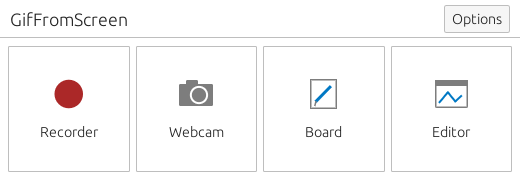
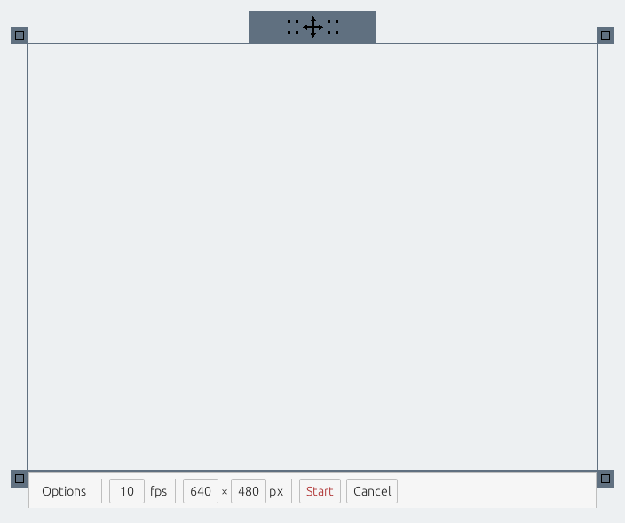
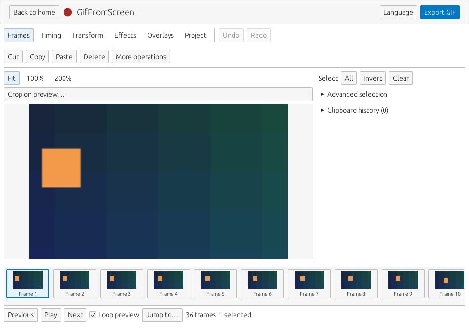

# Desktop interface

Version 0.1.6 uses a compact desktop-tool layout. The startup and recorder
screens follow the arrangement requested from ScreenToGif's public interface;
all controls and vector icons are implemented in this project's egui code.

## Start

The initial window is 520 × 190 logical points, with four equal entry tiles:
**Recorder**, **Webcam**, **Board**, and **Editor**. Options contains language,
theme, import/create actions and recent projects. Cards accept full-area clicks,
Tab focus, Enter and Space. The default theme is light; dark mode is available.

Returning home restores its size from before opening a work page (520 × 190 by
default). Manual home resizing is retained separately from editor and recorder
geometry. Restoration resets the work-window minimum and waits for native
recording restoration to finish; UI zoom does not multiply the saved size.

Recorder opens the capture frame once the source catalog and default save path
are valid. Invalid or existing output paths leave the setup page visible, with
an inline error and a native **Choose save location** dialog. Cancel the frame
to return to setup and change source, cadence or destination. Import and editor
screens expand the small launcher to a working window.

## Record

The X11 frame has a transparent capture area, a thin slate border, an owned move
grip, and four corner resize handles before recording. The bar follows the
capture width, with a 480-point minimum where the screen permits. It contains
Options, capture FPS, width × height, and recording actions. Narrow windows and
large fonts wrap controls while retaining accessible Start/Stop/Cancel actions.

Options reveals scrollable snapping, precise position and timing controls.
Recording locks the canvas size. Pause, Stop and Discard retain their existing
behavior. GIF FPS controls recording samples independently of pointer movement.

Native X11 pointer events move the frame directly, without waiting for UI/GPU
frames. The controls stay stationary during a drag and relocate on release.
Moving during recording still requires an acknowledged held capture pause and
a final geometry/exclusion check before resume. See [drag scheduling](RECORDER-DRAG-CADENCE.md).

## Edit and export

Tool categories and common frame actions are at the top. Wide windows place
the preview on the left/center and a resizable tool inspector on the right.
Narrow windows stack those areas in the page's scroll view. The preview adapts
to window height to leave room for the frame strip and playback controls below.
Filmstrip rendering remains virtualized; large projects do not create a widget
for every frame.

**Export GIF** opens the Project tab, expands export settings and scrolls them
into view. It pauses preview and does not start an export. Import, Save As,
annotations and additional project operations remain available in the Project
category. Undo/redo and existing edit commands retain their project semantics.

## Text reflow in 0.1.5

Long section titles wrap within their page. Dropdowns reserve a usable line
before painting, path pickers reserve space for Browse, and forms stack labels
above values when two columns no longer fit. Import, camera, board and creation
pages scroll vertically. The recorder setup action stays above its settings;
its coordinate labels stay with their fields. The language window fits the
available width and scrolls when necessary.

The layout regression suite inspects rendered glyph rows for intersections and
horizontal clipping. It covers 11 page routes, all six editor categories,
text/image/shape/drawing overlays, custom GIF export and the language window.
The matrix includes English and Chinese, widths from 320 to 960 logical points,
and font scaling up to 2×, with wheel input through long pages and inspectors.
The recorder bar is checked separately from 240 to 640 points, in ready,
recording and paused states, with Options open and closed. Intentional text-field
scrolling and partial rows at vertical scroll boundaries are excluded.

## Verification and scope

- 859 desktop tests pass, including the new layout audit and existing input,
  focus, capture-state and editing regressions.
- All 18 explicitly isolated native recorder-guide tests pass, including movement
  with the UI unpolled, permission revocation, capture exclusions, grab cleanup
  and the 30-second gesture watchdog.
- Clippy with warnings denied, formatting and installer tests pass.
- Native screenshots use an owned 1024 × 768 Xvfb server and isolated config,
  state and data directories. The editor shows the CLI-generated 36-frame demo.
  The recorder's plain gray area is the empty test desktop visible through it.
- A separate native run completed recording and stopped into the editor.

Xvfb verifies window behavior and server acceptance, not physical monitor FPS.
The movement change applies to X11; Wayland continues through desktop portals.
Project schema 8 and Vector v1 are unchanged. English and Simplified Chinese
catalogs contain 870 messages; other registered languages fall back to English.
